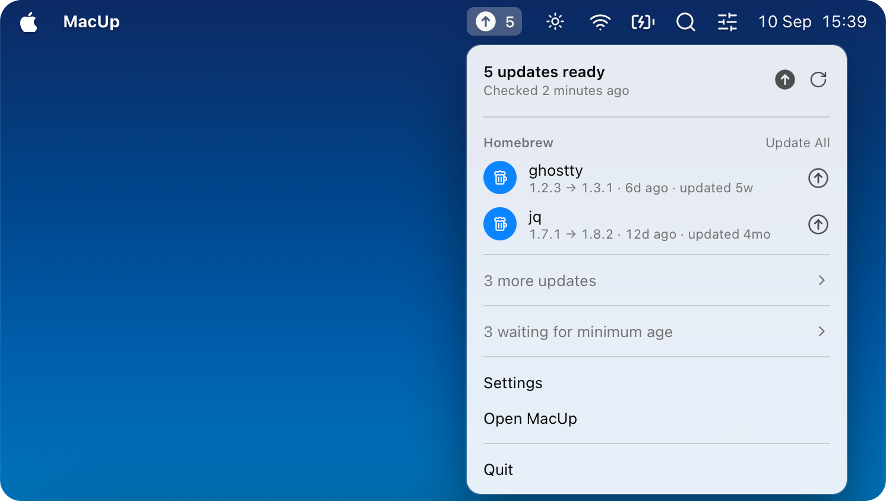

<p align="center">
  
</p>

<h1 align="center">MacUp</h1>

<p align="center">Keep your command-line tools up to date, from the menu bar.</p>

<p align="center"><a href="https://macup.patriciobcs.com">macup.patriciobcs.com</a></p>

<p align="center"><a href="https://github.com/patriciobcs/macup/actions/workflows/ci.yml"></a> <a href="https://codecov.io/gh/patriciobcs/macup"></a></p>

MacUp is a macOS menu bar app for developers. It finds the package managers on your Mac, shows what is outdated with the release date and any known vulnerability, and updates it in one click using each manager's own commands. It needs no configuration to be useful.

Free and open source under the MIT license. Requires macOS 14 or later, Apple Silicon or Intel.

## Install

```sh
brew install --cask patriciobcs/tap/macup
```

Or download `MacUp.dmg` from the [latest release](https://github.com/patriciobcs/macup/releases/latest), open it and drag MacUp to Applications. Every release is signed with an Apple Developer ID and notarized.

MacUp keeps itself current the way it was installed. A Homebrew install lists its own cask among the updates and relaunches after upgrading. A downloaded copy updates through [Sparkle](https://sparkle-project.org). Each copy uses exactly one of the two.

## What it does

- **Discovers package managers and installations.** Finds desktop apps, native CLIs, global packages and language runtimes. Installations lists their paths, owners and update actions, including inactive prefixes and leftovers that need review.
- **Waits for releases to settle.** An update is shown once the release is at least a day old, a security fix after four hours. Both thresholds are adjustable. Waiting gives maintainers time to pull a broken or compromised release before it reaches you.
- **Shows the facts.** When the release was published, when your copy was installed, and whether the installed version has an advisory in [OSV.dev](https://osv.dev).
- **Installs on its own, if you ask.** Off by default. Turn it on and MacUp installs what has passed the minimum age on a schedule you pick, leaving macOS updates and anything needing an administrator password for you to do knowingly.
- **Keeps copies separate.** Two npm prefixes have different identities and commands. Inactive copies, runtimes and vendor app updaters require an explicit action; scheduled updates leave them alone. Ignored packages and history migrate to the original active copy.
- **Runs the real commands.** Updates and removals use the manager's own tooling. Output streams into a log, and every action is recorded in a history.
- **Respects the system.** Packages owned by macOS itself, such as the system Ruby's gems, are hidden by default. Anything that needs an administrator password asks through the standard macOS prompt, never a stored credential. The few Homebrew casks whose upgrade runs through sudo, such as Docker Desktop, are opened in Terminal instead, where sudo asks for the password itself.
- **Errors you can act on.** A failed manager shows one plain sentence with Retry, Copy Details and Report on GitHub. Being offline is one notice, not a list of errors.
- **Works from the terminal too.** `macup upgrade` does what Update All does, with the same settings.

## Command line

The Homebrew cask puts `macup` on your PATH. With a downloaded copy, use **Settings → Command line tool → Install**.

```sh
macup                     # what is ready to update, and what is still waiting
macup check               # check now, then show the same
macup upgrade             # update what is ready, like Update All
macup upgrade npm cargo   # only these package managers
macup upgrade --now       # include updates still waiting out the minimum age
macup upgrade --dry-run   # print the commands, change nothing
macup ignore npm:left-pad # stop offering a package (unignore to undo)
macup status --json       # for scripts
macup inventory --json    # installation IDs, paths, owners and known latest versions
macup inventory apps runtimes
macup upgrade --now --installation="<id from inventory>"
macup remove --dry-run "<id from inventory>"
```

It uses the menu bar app's settings, ignored packages and history, and the app shows what it did. The two never update at the same time: whichever starts second waits, or is told to try again. With no terminal attached, for example from cron, anything that needs an administrator password is skipped, and `--skip-admin` does the same by hand. macOS updates are only handed off to System Settings when named (`macup upgrade macos`). The exit status is 0 when everything worked, 1 when something failed, and 64 for a mistyped command.

## Supported package managers

| Manager | Detects outdated | Update | Remove | Release date | Advisories |
|---|---|---|---|---|---|
| Homebrew (formulae and casks) | `brew outdated` | yes | yes | Homebrew bump commit | no |
| npm, Bun, pnpm (global) | native | yes | yes | npm registry | OSV (npm) |
| pip, pipx, uv tools | native / PyPI | yes | yes | PyPI | OSV (PyPI) |
| Conda (base environment) | solver dry run | yes | no | no | no |
| rustup toolchains | `rustup check` | yes | no | rustup output | no |
| Cargo (installed crates) | crates.io | yes | yes | crates.io | OSV (crates.io) |
| Go binaries | Go module proxy | yes | yes | Go module proxy | OSV (Go) |
| RubyGems | `gem outdated` | yes | yes | RubyGems | OSV (RubyGems) |
| Composer (global) | native | yes | yes | Packagist | OSV (Packagist) |
| Nix (`nix-env`) | dry-run upgrade | yes | yes | no | no |
| mise | `mise outdated` | yes | no | no | no |
| MacPorts | `port outdated` | yes, admin | yes, admin | no | no |
| Mac App Store (via `mas`) | `mas outdated` | yes | no | no | no |
| macOS updates | `softwareupdate` | opens System Settings | no | no | no |
| Google Cloud CLI (direct SDK install) | `gcloud components list` | SDK and components in Terminal | no | first seen | no |
| Tailscale (standalone macOS app) | Tailscale's package feed | opens Tailscale's updater | no | first seen | no |
| Self-installed tools (uv, Bun, Deno, pnpm, mise) | GitHub releases | self-update | no | GitHub | no |
| Claude Code / Devin (native installers) | vendor release channel / manifest | native updater | no | first seen | no |
| OrbStack (direct install) | `orbctl update --check` | native updater, manual | no | first seen | no |
| Desktop apps | Sparkle appcasts, Electron metadata, curated GitHub releases | opens app or vendor page | no | first seen | no |
| Standalone Node.js | official distribution index, same major | verified runtime replacement, manual | no | first seen | no |
| uv-managed Python | native JSON inventory and download catalog, same minor | `uv python upgrade`, manual | no | first seen | no |
| Java installations | on-disk vendor, version and architecture | opens vendor page; latest unknown | no | no | no |
| GitHub CLI extensions | authenticated `gh api` | native | native | first seen | no |
| .NET global tools | NuGet stable versions; configured sources stay native | native global update | native | first seen | no |
| Dart / Flutter global tools | configured Pub host | native global activation | native | first seen | no |
| Modern Nix profiles | per-entry native dry run | exact profile and selector, manual | native | first seen | no |
| asdf / Volta | native tools / official Node index | home tool selection, manual | no | first seen | no |

## Privacy

MacUp has no accounts and no telemetry. Existing package-manager adapters query their registries for latest versions and release dates, and send supported package names and installed versions to OSV.dev for advisories. Installation discovery also checks vendor app feeds, GitHub release repositories, the Node distribution index, NuGet and the configured Dart Pub host. These checks can happen for current installations as well as outdated ones.

npm prefix checks use native npm, preserving registry configuration and authentication. Public release-date and advisory lookups are made only after npm confirms the package uses the public npm registry; other scoped installations use first-seen dates without public advisory queries. GitHub extensions use authenticated `gh api`. User-configured NuGet sources stay with the native .NET CLI rather than sending tool names to public NuGet. Vendor app feeds are read for version information; MacUp never executes an installer URL from a feed. Package managers contact their configured services as usual. Nothing adds an identifier beyond normal network requests and their IP address. State and action plans, including installation paths, live in `~/Library/Application Support/Macup`.

## Limitations

- **Release dates for Homebrew** come from GitHub's API, limited to 60 anonymous requests per hour. Results are cached per version, so a fresh install with many outdated formulae shows "first seen" for some of them until the cache fills over a few scans.
- **Advisories** cover the ecosystems OSV.dev indexes. Homebrew formulae, Conda, Nix, mise and macOS updates are not checked.
- **The release-age wait is a heuristic**, not a guarantee. It reduces exposure to releases that are pulled quickly; it does not detect a compromised release on its own.
- **Nix** supports both `nix-env` and modern profiles. Profile updates preview one unlocked flake reference at a time; locked references remain visible without an automatic update action. Project `flake.lock` files are untouched.
- **Self-update of tools** applies only to copies installed by their own installers. Copies from Homebrew or npm are updated by those managers. When a tool's own updater fails, MacUp runs the vendor's documented installer script over HTTPS.
- **Very old tool versions.** Scanning relies on each manager's machine-readable output, and some of those flags are not ancient: `pnpm outdated --format json` needs pnpm 7, `bun outdated -g` needs a recent bun (older ones are read from bun's global directory instead). A manager too old for its flag reports one error that names the version it is running, and the rest of the scan carries on.
- **Homebrew's bundled Python packages**, including pip, are updated with their Homebrew formula. For separately installed packages, MacUp logs any `--break-system-packages` retry after a PEP 668 refusal.
- **Homebrew's bundled Ruby gems** stay with their Ruby formula. MacUp checks gemspec and plugin symlinks into the Cellar, even when the surrounding gem directory is writable. Separately installed gems remain updatable, and user gems stay in the user gem directory.
- **macOS app installations and stale metadata.** For App Store apps, MacUp checks the installed bundle's identity, receipt and version rather than trusting Spotlight's cached version. Applications folders take precedence over downloaded copies; Trash, Time Machine backups, embedded helpers and read-only installer volumes are excluded. Missing or unreadable metadata preserves the App Store tool's report. Homebrew casks continue to use Homebrew's installation and version rules.
- **Desktop app discovery** covers `/Applications` and `~/Applications`, including nested app folders. App Store, Homebrew, Software Update and dedicated native adapters retain ownership of their apps. Other apps use an available vendor feed or appear with “latest version unknown.” Opening an app or vendor page is recorded as a handoff, never proof of an update. App updates must be completed in that updater and checked again.
- **Runtime updates** preserve the installed Node major and managed Python minor. Direct Node updates verify the vendor SHA-256 checksum, installed architecture, matching signing identity and reported version, replace the binary atomically, and roll back on verification failure. npm and other global packages remain in their prefix. Unsupported Python variants and Java installers remain manual. asdf and Volta change the home/default tool selection without editing project pins.
- **Inactive npm prefixes and orphaned command links** are inventory, not a request to install replacements. Select an exact installation before changing it; linked source checkouts have no npm update action. Broad Update All and scheduled updates skip inactive copies.
- **Update All skips manual runtime updates and vendor handoffs**, including macOS updates that can restart the Mac. Select their individual action knowingly.
- **Tailscale updates are manual.** The row opens Tailscale's own updater and is left out of Update All and scheduled updates. Homebrew and App Store copies stay with their original manager.
- **Google Cloud CLI** is updated as one SDK, including its installed components such as `bq` and `gsutil`. Its row opens Terminal because Google's updater may install or update system Python; Update All and scheduled updates leave it alone. Homebrew copies stay with Homebrew; installations with the component updater disabled are left to their installer.
- **MacUp is not sandboxed** and is distributed outside the Mac App Store, because the App Store sandbox does not allow an app to run Homebrew or npm on your behalf. See [SECURITY.md](SECURITY.md).

## Contributing

Issues and pull requests are welcome. [CONTRIBUTING.md](CONTRIBUTING.md) covers building the app, the checks and tests, and how to add a package manager. For security matters see [SECURITY.md](SECURITY.md).

## License

[MIT](LICENSE). Bundled third-party software is listed in [THIRD_PARTY.md](THIRD_PARTY.md).
